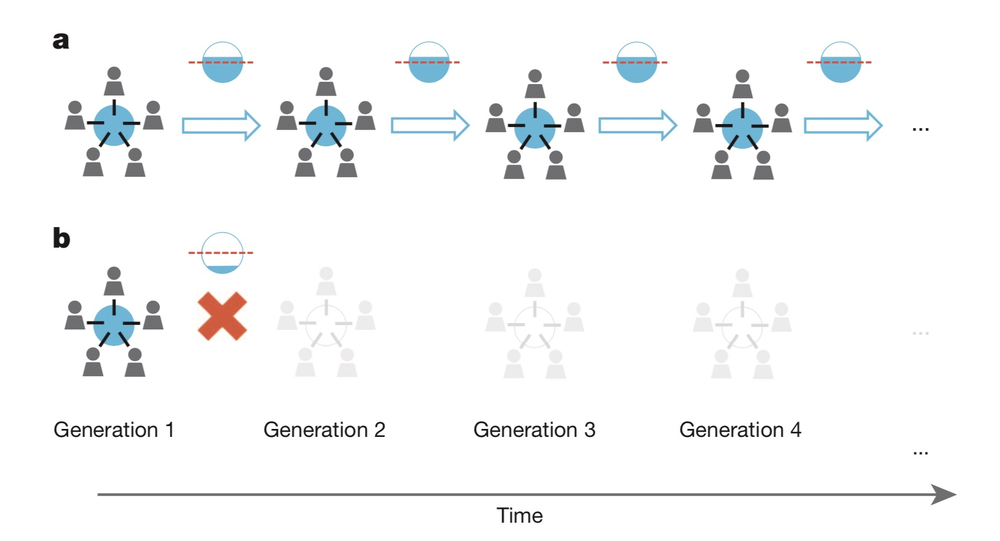
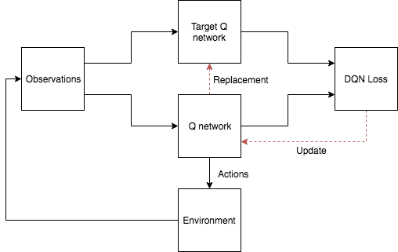
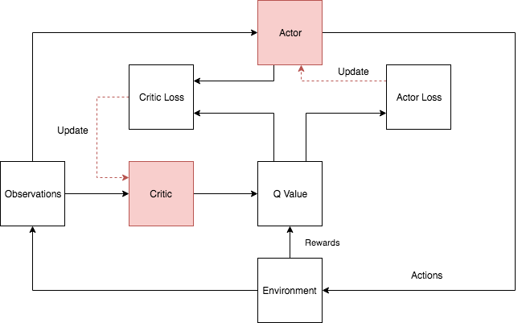

# Aprendizaje por Refuerzo Multiagente Profundo en un Sistema de Recursos de Uso Común

> :warning: **Atención**: este repositorio utiliza las APIs de TensorFlow v1, las cuales han sido descontinuadas y migradas a TensorFlow v2. En consecuencia, el código fuente actual ya no funcionará como se esperaba.

Este proyecto incluye el código fuente del artículo: [Aprendizaje por Refuerzo Multiagente Profundo en un Sistema de Recursos de Uso Común](https://ieeexplore.ieee.org/abstract/document/8790001/), el cual fue aceptado y publicado en *IEEE CEC 2019*.

## Introducción

En sistemas socioecológicos complejos, múltiples agentes con objetivos diversos realizan acciones que afectan la dinámica a largo plazo del sistema. Los recursos de uso común son un subconjunto de estos sistemas, donde los derechos de propiedad suelen estar mal definidos y la dinámica es desconocida a priori, creando un dilema social reflejado por la conocida **tragedia de los comunes**. En este artículo, investigamos la eficacia del aprendizaje por refuerzo profundo en un entorno multiagente de un sistema de recursos de uso común. Utilizamos un modelo matemático abstracto del sistema, representado como un juego markoviano de suma general parcialmente observable. En el primer conjunto de experimentos, los agentes independientes utilizaron una Red Q Profunda con espacios de acción discretos para guiar la toma de decisiones. Sin embargo, se evidenciaron deficiencias significativas. Como consecuencia, en un segundo conjunto de experimentos, un modelo de aprendizaje de Gradiente de Política Determinista Profunda con espacios de estado y acción continuos guió el aprendizaje de los agentes. Los resultados de las simulaciones muestran que los agentes tuvieron un rendimiento significativamente mejor en términos tanto de sostenibilidad como de objetivos económicos al utilizar el segundo modelo de aprendizaje profundo. Aunque es cierto que los agentes no poseen una visión perfecta del futuro ni comprenden del todo las implicaciones de sus esfuerzos de "explotación", el aprendizaje por refuerzo profundo puede emplearse de manera efectiva para "aprender en lo común".

Una demostración de un sistema CPR simplificado [[Hauser, Oliver P., et al.]](https://www.nature.com/articles/nature13530):



## Requisitos previos

Asegúrese de tener `Python3.11` instalado en su máquina.

En el directorio raíz, ejecute el comando para instalar
```commandline
pip install .
```

## Ejecutar la demo
```
./run_demo
```

## Modelos
Puede elegir entre los siguientes modelos:

- `DQN`:  [Red Q Profunda](http://www.davidqiu.com:8888/research/nature14236.pdf)

- `DDPG`: [Gradiente de Política Determinista Profunda](https://arxiv.org/abs/1509.02971)

## Interacción agente-entorno


## Arquitectura DQN



## Arquitectura DDPG


## Referencias

1. [von der Osten F B, Kirley M, Miller T. Sustainability is possible despite greed-Exploring the nexus between profitability and sustainability in common pool resource systems[J]. Scientific reports, 2017, 7(1): 2307.](https://www.nature.com/articles/s41598-017-02151-y)
2. [Hausknecht, M., & Stone, P. (2015). Deep recurrent q-learning for partially observable mdps. CoRR, abs/1507.06527.](http://www.aaai.org/ocs/index.php/FSS/FSS15/paper/download/11673/11503)
3. [Hauser, O. P., Rand, D. G., Peysakhovich, A., & Nowak, M. A. (2014). Cooperating with the future. *Nature*, *511*(7508), 220.](https://www.researchgate.net/profile/David_Rand2/publication/263815931_Cooperating_with_the_future/links/553f5e900cf24c6a05d208d1.pdf)
4. [Mnih V, Kavukcuoglu K, Silver D, et al. Human-level control through deep reinforcement learning[J]. Nature, 2015, 518(7540): 529.](http://www.davidqiu.com:8888/research/nature14236.pdf)
5. [Kulkarni T D, Narasimhan K, Saeedi A, et al. Hierarchical deep reinforcement learning: Integrating temporal abstraction and intrinsic motivation[C]//Advances in neural information processing systems. 2016: 3675-3683.](http://papers.nips.cc/paper/6233-hierarchical-deep-reinforcement-learning-integrating-temporal-abstraction-and-intrinsic-motivation.pdf)
6. https://github.com/Ceruleanacg/Reinforcement-Learning
